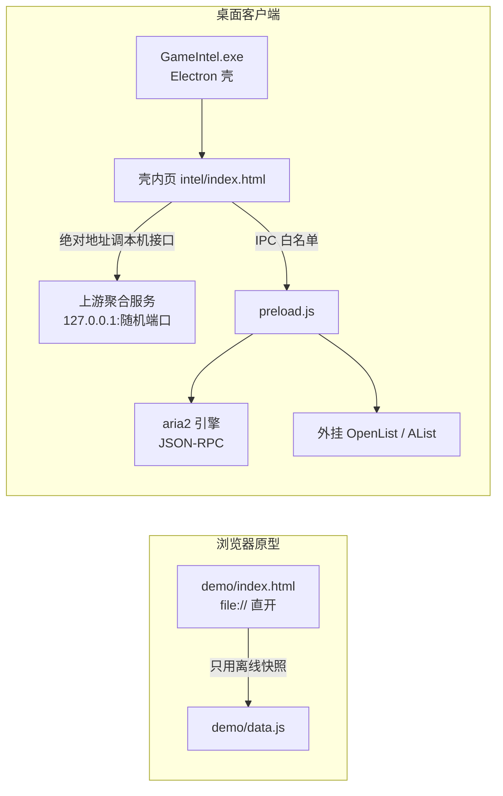

# GH-GameGather APP

本地优先的 **PC / 手游情报站 + 资源检索 + 桌面下载管理**。最终产物是一个双击即用的 Windows 桌面应用。

### 只要记住这一个链接

## 👉 https://github.com/A13612812330/GH-GameGather-APP

打开它，下面四件事都能从这里走到，不需要再记第二个地址：

| 你想干什么 | 从这里点 | 说明 |
|---|---|---|
| **直接就能用**（不装任何东西） | [**Releases · 最新成品包**](../../releases/latest) | 262 MB zip → **整个文件夹解压** → 双击 `GameIntel.exe`。⚠️ **别只拷 exe**（会报 ICU 错误） |
| **读代码 / 改界面与壳** | 本仓库 `demo/` + `electron/` | `git clone` 后 `cd electron && npm i` |
| **要实时数据 / 改数据服务** | [GH-GameGather-UPSTREAM](https://github.com/A13612812330/GH-GameGather-UPSTREAM) | 配套 Express 服务 + 93.6 MB JSON 索引快照 |
| **只想看看界面长什么样** | 双击 `demo/index.html` | 0 依赖、不联网，读离线快照 |

> ⚠️ **单 clone 本仓库跑不出完整 App** —— 本仓不含上游数据服务、Electron 运行时与成品。
> 逐项判定表见 [`HANDOVER` §0.1](./HANDOVER-GH-GameGather-APP.md)，三条复刻路线见 §0.2。

> **只做信息聚合与索引** —— 不托管、不分发任何游戏文件。所有资源条目都指向原始出处，
> 下载能力只覆盖**磁力/BT 与真实直链**。

> **关于名字**：原名「游戏情报客户端 / GameIntel」，2026-10-26 定名 GH-GameGather APP。代码目录名、exe 名
> 与包内路径仍沿用 `GameIntel`，未做重命名 —— 改名会让打包脚本与既有验证指纹全部失效，见 [`HANDOVER` §六](./HANDOVER-GH-GameGather-APP.md)。

---

## 一、它能做什么

| 能力 | 说明 |
|---|---|
| **情报浏览** | PC 新游 / 热游、修改器、MOD、手游新游 / 活动 / 可玩端游；统一**分页 50 条**，页内跨源同款合并成一条 |
| **首页** | 大图轮播 → 三块精选（PC 新游 10 / PC 热游 10 / 手游新游 6）→ **四个排行榜**（PC 新游 / PC 热游 / 手机新游 / 手机热游，v27 起默认各露 Top 5，可展开全部 12） |
| **详情弹窗** | 点击任意卡片/榜行打开，字段对齐工作台全量；含评分、机型 / 芯片规格、多源同款标记 |
| **全局搜索** | 入口即弹窗，结果也在弹窗里，可直接进详情 |
| **我的游戏 / 游戏库** | 本地游戏与库记录按 `sid:<appid>` 优先、`nm:<归一化名>` 兜底关联；关联支持双向回写 |
| **下载管理** | aria2 引擎（磁力 / BT / 直链）、任务持久化与引擎对账、解压历史。**链接按形态分四类**：真直链→引擎直下；**磁力链**→引擎（可回列表选文件）；`thunder://`/`ed2k://`→只复制给对应客户端；**网盘分享页→打开网盘自己转存**（自动转存是可选外挂 OpenList，只调它的 API，不打包） |
| **管理页** | 独立窗口形式的本 App 工作台（单例，与主窗并存） |
| **两种主题** | 深色（默认，深蓝黑 + 品牌绿）/ 浅色，同一套 token；壳内另切「桌面客户端形态」 |

---

## 二、一份代码，两种运行形态



**关键定式**（都是踩过坑才定下来的，改架构前请先读 `PACK-GameHub-exe.md`）：

1. 情报站从包内 **`file://` 直开**，用**绝对地址**调本机接口 —— 上游自带 `ACAO:*`，不需要反代。
2. 端口**不能写死 8123**：壳的上游会因 `EADDRINUSE` 自动 +1，页面取 `SHELL.describe().listenPort` 优先、取不到才退回。
3. 上游 `server.js` 是**实时接口唯一来源**，必须进包；但**不把 demo 拷进上游 `public/`**。
4. 壳源码在 `resources/app/`、**不在 exe 里** ⇒ 改壳后 exe 的 md5 不变，判新旧要看包内 `intel/index.html`。

---

## 三、目录

```
.
├─ demo/                      前端原型（单文件，无构建、无依赖）
│  ├─ index.html              全部 UI + 逻辑（6,448 行 / 376 KB）
│  ├─ data.js                 离线数据快照（497 KB）
│  ├─ _t_demo.js              jsdom 行为断言（803 条）
│  ├─ _shot.py                Chrome CDP 截图（不依赖 PIL）
│  ├─ _contrast_v25.py        深色色板对比度核验
│  └─ README.md               原型实现细节与验证记录
├─ electron/                  Electron 壳
│  ├─ main.js                 窗口 / 托盘 / IPC / 上游子进程
│  ├─ preload.js              contextBridge 白名单
│  ├─ aria2.js                aria2 JSON-RPC 封装
│  ├─ pack.py                 打包脚本，产出 dist/GameIntel
│  ├─ vendor/aria2/           aria2c.exe 5.4 MB + GPLv2 三件（2026-10-26 起入库）
│  ├─ _t_shell.js             壳契约断言（73 条）
│  └─ _t_aria2.js             引擎断言（27 条）
├─ exe-preview/index.html     版本实拍档案页（截图未入库，见 §六）
├─ HANDOVER-GH-GameGather-APP.md  移交说明（接手先读这一份）
├─ SOP-游戏情报客户端.md       规范与红线
├─ PLAN-游戏情报客户端.md      方案与模块（M0–M13）
├─ NEXT-游戏情报客户端.md      待办与路线（P0–P3）
└─ PACK-GameHub-exe.md        exe 打包方案与逐版记录
```

> 公开仓库**不含**内部工作记忆与第三方成品逆向分析材料 —— 这两类留在维护者本地，不进版本库（见 `.gitignore` 末段）。

---

## 四、怎么写、怎么验

### 看原型（最快，不需要装任何东西）

直接双击 `demo/index.html`。它只读 `data.js` 的离线快照，**不连任何服务**。

> 若要连实时库，需要用本地 HTTP 起一个静态服务（`file://` 下 `fetch` 会被拦），
> 并保证上游聚合服务在跑。

### 跑断言

```bash
# 页面行为断言（jsdom，803 条）
cd demo && NODE_PATH=<jsdom 所在目录> node _t_demo.js

# 壳契约（73 条）+ 引擎（27 条）
cd electron && node _t_shell.js && node _t_aria2.js
```

三套都必须全绿才算完成一轮改动。**改实现后必须同轮改断言并写明理由** ——
本项目不接受「断言改小了但没解释」。

### 打包成 exe

```bash
python electron/pack.py
```

产物 `dist/GameIntel/`（**10,100 个文件 / 591.3 MB**，顶层 22 个条目）。

> **不是绿色单文件**：只拷 `GameIntel.exe` 会报 `Invalid file descriptor to ICU data received.`，
> 补上 `icudtl.dat` 又换报 `Error loading V8 startup snapshot file`。
> **必须整个目录一起搬**。要单文件分发只能做安装包。

### 真实窗口截图（自查用）

```bash
env -u ELECTRON_RUN_AS_NODE ./node_modules/electron/dist/electron.exe . --shot=E:/shots/x.png
```

`SHOT_WAIT_MS` 控等待，`SHOT_JS` 可先执行页面 JS（**返回字符串，别返回 Promise**）。
`ELECTRON_RUN_AS_NODE=1` 在本机环境里是预设变量，不 `env -u` 掉跑不起来。

---

## 五、版本节点

| 版本 | 做了什么 |
|---|---|
| v9 | 深色主题 + 排行榜（按维度分榜） |
| v10 | 分榜固定 2 列、首页去孤行；计数改为榜上实际行数 |
| v11 | 图片适配：按「最狠裁切」而非均值定比例（16/9 → 3/2） |
| v12 | 移除「端游可视报告」模块，侧栏 10 → 9 |
| v15 | 新增本机三页：游戏库 / 我的游戏 / 下载管理 |
| v16 | 去掉数量展示、统一分页 50、搜索改弹窗、学开源项目重做交互 |
| v17 | 详情页对齐工作台、多平台同款合并（列表页内 + 详情层） |
| v18 | 工作台变成独立窗口「管理页」，关联双向回写 |
| v19 | 接入 aria2 引擎：任务列表、暂停/继续、磁力解析 |
| v20–v24 | 下载管理成型：四步网盘链、折叠式设置区、任务持久化与引擎对账 |
| v25 | 视觉重制（参考 games.gg）：深蓝黑色板、6 级圆角、卡片上浮、胶囊 +N 折叠 |
| v26 | 排行榜下沉到首页底部，移除侧栏独立入口（页面保留作深链） |
| v27 | 首页榜单默认只露 Top 5，其余折叠可展开 |
| **v28** | **链接四分类**：真直链 / **磁力链**（交给 aria2 真下）/ 迅雷·电驴专用链（只复制）/ 网盘分享页（**打开网盘自己转存**）；
顺带修两个真 bug：进度回推把任务 `url` 覆盖成空、对账只按 url 匹配导致磁力任务重启后被判失败 |

每一版的取舍理由与验证数据都在 `PACK-GameHub-exe.md` 的对应小节里，
包括**被数据否掉的做法**（例：竖版 6:9 海报比例 —— 651 张真实图实测最狠裁切从 33.3% 涨到 68.8%，故否决）。

---

## 六、边界与依赖

| 项 | 说明 |
|---|---|
| **上游聚合服务** | 独立项目，本仓库**不含**它的源码（只读依赖）。成品打包时从本机只读拷贝进包。⚠️ **没有它就只能看离线快照**，移交时须单独提供。 |
| **网盘下载** | 外挂 OpenList / AList，**只调用它的 API**。对方是 AGPL ⇒ **只调用、不分发、不打包**。 |
| **aria2** | GPLv2。`electron/vendor/aria2/` **已入库**（2026-10-26 起），内含 `aria2c.exe` + `COPYING` + `LICENSE.OpenSSL` + `SOURCE-OFFER.txt`，`pack.py` 直接取用。 |
| **截图** | `exe-preview/shots/`（77 张 / 35 MB）**未入库**。需要时本地重拍；因此 `exe-preview/index.html` 在 GitHub 上会有空图位。 |
| **游戏文件** | 一律不托管、不转发。资源条目只做索引与跳转。 |

---

## 七、给接手的人三句话

> 完整的接手手册见 **[`HANDOVER-GH-GameGather-APP.md`](./HANDOVER-GH-GameGather-APP.md)** —— 环境、打包、缺什么、红线、常见故障都在里面。

1. **先比 md5 再决定要不要重跑验证** —— 指纹一致说明代码没变，既有结论继续有效（见 `NEXT` §0 现状锚点）。
2. **断言只守得住「实现符合设计」，守不住「设计本身想错了」** —— 交互链路必须实拍，而且探针要走用户真实点击那条路径。
3. **改动前后各存一次指纹**，跑完立刻 `md5sum` 存证；否则「跑完又改源码」会让结论当场过期。
